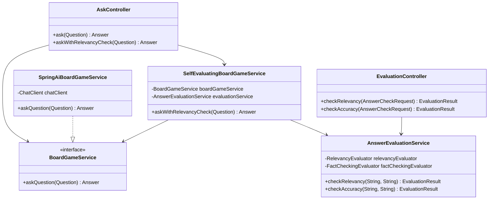

# Spring AI Board Game Buddy

REST API sederhana untuk bertanya tentang permainan papan menggunakan Spring AI. Aplikasi menyediakan endpoint untuk meminta jawaban, mengecek relevansi dan akurasi jawaban, serta meminta jawaban yang diperiksa relevansinya.

## Persiapan

- Java 17 atau lebih baru
- Koneksi internet dan API key dari router AI
- Maven tidak perlu dipasang karena proyek menyertakan Maven Wrapper

Konfigurasi bawaan pada `src/main/resources/application.properties`:

| Pengaturan | Nilai bawaan |
|---|---|
| Router API | `https://router.bynara.id/` |
| Model | `gpt-6-luna` |
| Port aplikasi | `8080` |

Jika router atau model yang digunakan berbeda, sesuaikan nilai pada file `application.properties`.

## Menjalankan aplikasi

Buka PowerShell di folder proyek. Jika Java belum tersedia di PowerShell, atur lokasi JDK terlebih dahulu. Contoh berikut memakai JDK 23:

```powershell
$env:JAVA_HOME = "C:\Program Files\Java\jdk-23"
$env:Path = "$env:JAVA_HOME\bin;$env:Path"
```

Atur API key dan port, lalu jalankan server:

```powershell
$env:SPRING_AI_OPENAI_API_KEY = "API_KEY_DARI_ROUTER"
$env:PORT = "8082"
.\mvnw.cmd spring-boot:run
```

Biarkan jendela PowerShell server tetap terbuka. Aplikasi tersedia di `http://localhost:8082`. Jika port `8082` sedang digunakan, pilih port lain dengan mengubah nilai `PORT`.

## Mencoba endpoint

Buka jendela PowerShell baru. Sesuaikan port pada URL jika server menggunakan port lain.

### Meminta jawaban

```powershell
Invoke-RestMethod -Method Post -Uri "http://localhost:8082/ask" -ContentType "application/json" -Body '{"question":"Apa strategi dasar bermain catur?"}'
```

### Meminta jawaban yang diperiksa relevansinya

```powershell
Invoke-RestMethod -Method Post -Uri "http://localhost:8082/ask/verified" -ContentType "application/json" -Body '{"question":"Apa strategi dasar bermain catur?"}'
```

Endpoint ini mencoba menghasilkan jawaban yang relevan hingga dua kali. Jika jawaban tetap tidak lolos evaluasi, aplikasi mengembalikan pesan pengganti.

### Mengevaluasi relevansi dan akurasi jawaban

```powershell
Invoke-RestMethod -Method Post -Uri "http://localhost:8082/evaluate/relevancy" -ContentType "application/json" -Body '{"question":"Apa fungsi pion dalam catur?","answer":"Pion bergerak maju satu petak dan menangkap secara diagonal."}'

Invoke-RestMethod -Method Post -Uri "http://localhost:8082/evaluate/accuracy" -ContentType "application/json" -Body '{"question":"Apa fungsi pion dalam catur?","answer":"Pion bergerak maju satu petak dan menangkap secara diagonal."}'
```

Hasil evaluasi mencakup kriteria, nilai `passed`, pertanyaan, dan jawaban. Karena evaluasi dilakukan oleh model AI, penilaiannya dapat berbeda dari penilaian manusia atau berubah pada percobaan lain.

Input pertanyaan dan jawaban yang kosong atau terlalu panjang ditolak oleh validasi aplikasi.

## Menjalankan tes

Tes otomatis tidak memanggil layanan AI dan tidak memerlukan API key. Jalankan dari folder proyek:

```powershell
.\mvnw.cmd test
```

Tes memeriksa bahwa jawaban relevan diterima, dan jawaban tidak relevan dicoba kembali sebelum aplikasi memberikan pesan pengganti.

## Struktur kelas


